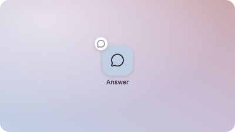
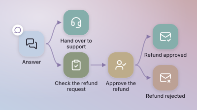
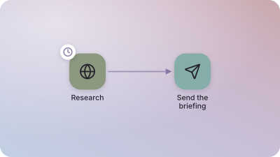
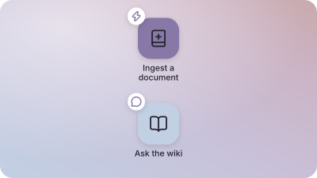

# Examples

Workflow templates: complete workflows to start from. A platform that offers them clones this
repository, lists its templates beside the ones an environment holds, and copies a template
into an environment as a new workflow on request. After that copy the workflow is the
environment's own, and nothing at run time reads this repository.

Every template is a workflow for the [archmax harness](https://harness.archmax.ai): a
`workflow.yaml` that validates with no error and no warning, its states placed on the canvas,
and what it cannot know about your organization left as notes on the canvas, each beginning
"To do:".

## The templates

| | Template | Connections |
| --- | --- | --- |
|  | **Minimal chat** — one state that answers each chat message. The smallest workflow to talk to, and the start of one of your own. | none |
|  | **Customer support chat** — answers customers in the chat, hands a conversation over to your support team, and takes refund requests to a person who approves or rejects them before the customer is emailed. | Microsoft Outlook |
|  | **Daily research** — every morning, reads the pages you follow and searches the web for your topics, then emails you a short briefing with a link to every source. | Microsoft Outlook, and the platform's browser tools |
|  | **OneDrive wiki** — turns the documents you drop into a OneDrive folder into a wiki the agent writes and keeps up to date, and answers questions from it in the chat, citing its pages. | Microsoft OneDrive |

## Layout

```
templates/<id>/template.yaml   # required: what the template is called, and what it needs
templates/<id>/workflow.yaml   # required: the workflow a new one is created from
templates/<id>/preview.svg     # its preview, drawn by scripts/render-previews.mjs
templates/<id>/...             # anything else is copied with the workflow (hooks/, tests/)
```

One level: every direct child of `templates/` that holds both a `template.yaml` and a
`workflow.yaml` is one template, and its **directory name is the id**, which a new workflow's
identifier starts from. Ids are lowercase letters, digits and hyphens (`customer-support-chat`).
A directory without either file, with any other name shape, or holding a symbolic link is no
template. `template.yaml` and `preview.svg` are for browsing and are not copied.

## `template.yaml`

```yaml
name: Customer support chat
description: >-
  Answers customers in the chat, hands a conversation over to your support team, and takes
  refund requests to a person who approves or rejects them before the customer is emailed.
order: 2
connections:
  - microsoft-outlook
```

- `name` — what a person sees in the list of templates; a new workflow takes it as its title.
- `description` — one or two sentences saying what the workflow does, in the words of someone
  who will use it, not build it.
- `order` — where the template is listed: lower first. The simplest template comes first.
- `connections` — the collections whose tools the workflow grants (`microsoft-outlook`,
  `microsoft-onedrive`), so a person sees before creating it what they will have to connect.

## The rules every template keeps

- `tools.allow_always` lists the twelve default tools, in the order the harness's skeleton
  does. A tool a state needs is granted in that state's `tools.allow`.
- No tool and no trigger names a connection: the environment's only connection of its
  collection serves it, and a new environment without one is asked to connect it.
- Every state carries `metadata.x`, `metadata.y`, `metadata.color` and `metadata.icon` (a
  lucide icon name). The canvas and the preview both draw from them.
- What a template cannot know — an address, a policy, a folder, a tool to add — is a yellow
  note in `metadata.notes` beginning "To do:", placed beside the states it is about.
- The workflow validates with no error and no warning.

## Previews

A preview is drawn from the workflow, never by hand, so every template's looks the same: each
state a tile in its colour holding its icon, its title under it, the transitions as arrows,
and a start state's trigger as a badge, on the archmax gradient. After changing a template:

```sh
npm install
npm run previews
```

## Contributing

Open a pull request adding `templates/<id>/`. [AGENTS.md](AGENTS.md) is the contract every
template is reviewed against.
